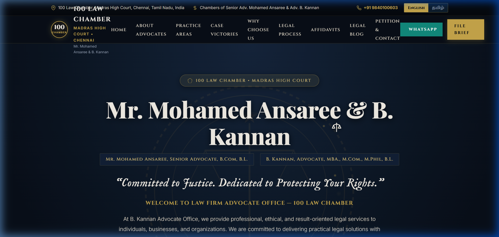
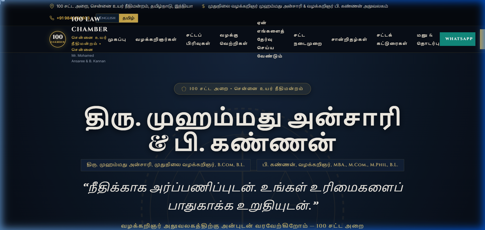
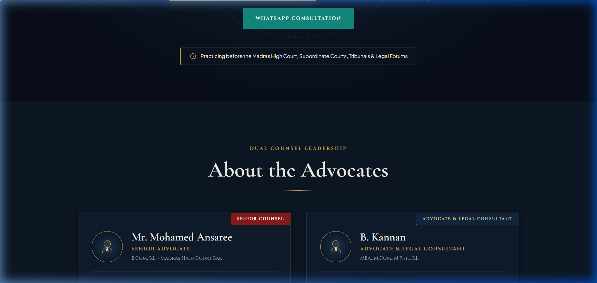
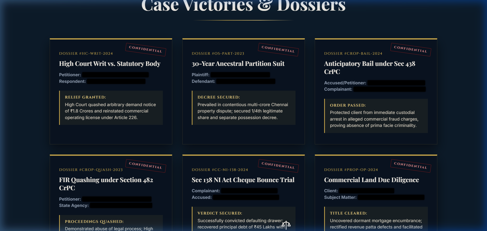
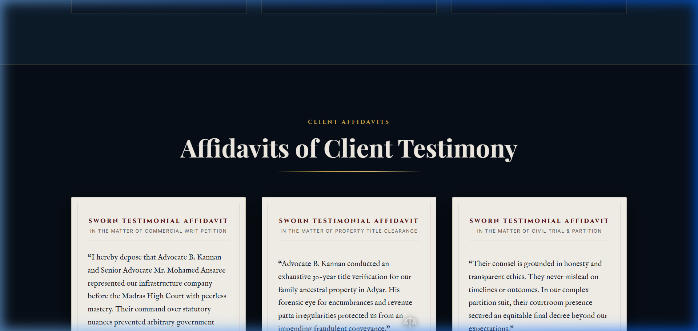
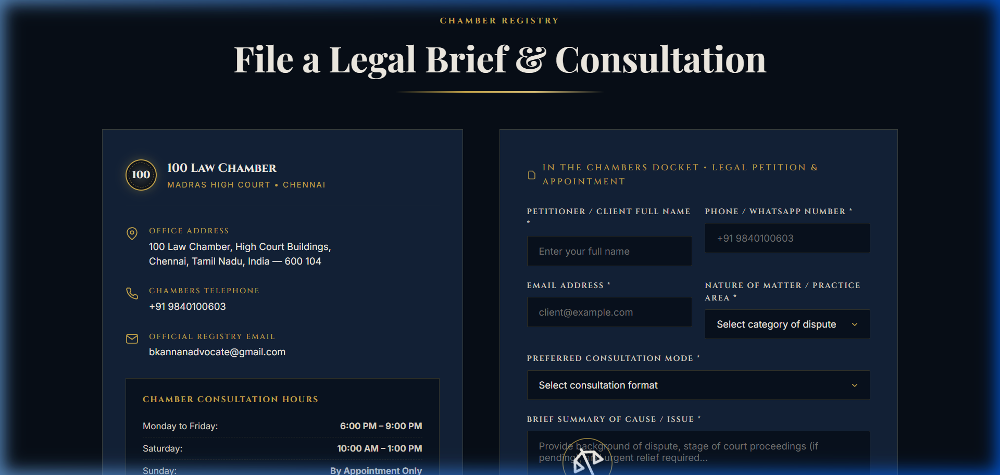

# 100 Law Chamber – Advocate Portfolio & Legal Practice Web Platform
### Chambers of Senior Advocate Mohamed Ansaree & Advocate B. Kannan | Madras High Court

[](https://opensource.org/licenses/MIT)
[](#)
[](#)
[](#)
[](#)

---

## 🏛️ Overview

**100 Law Chamber** is a premier digital legal portfolio and practice management portal engineered for the esteemed chambers of:
- **Senior Advocate Mr. Mohamed Ansaree** (B.Com, B.L.) – Senior Counsel at Madras High Court
- **Advocate & Legal Consultant B. Kannan** (MBA., M.Com., M.Phil, B.L.) – High Court Advocate & Strategic Consultant

This project integrates a responsive, luxury legal web platform with automated client petition handling, bilingual Tamil-English accessibility, and comprehensive technical documentation & automated report generation pipelines.

---

## ✨ Key Features

- **Luxury Legal Aesthetic**: Tailored dark-mode palette (`#080E18` midnight navy and `#C9A84C` antique gold), Cormorant Garamond & Cinzel typography, glassmorphism cards, and refined micro-animations.
- **Bilingual Interface (Tamil & English)**: Seamless real-time translation switch catering to clients across Tamil Nadu and the Madras High Court jurisdiction.
- **Interactive Practice Areas**: Civil litigation, criminal defense, family law, corporate compliance, property documentation, and constitutional writ petitions.
- **Client Petition & Consultation Booking**: Validated consultation booking form with WhatsApp direct-connect and instant inquiry dispatch.
- **Legal Insights & Case Victories**: Showcase of landmark judgments, client affidavits, and dynamic FAQ accordions.
- **Automated Technical Documentation**: Python scripts using `python-docx` and `matplotlib` to compile academic project reports, technical summaries, and system architecture diagrams.

---

## 📸 Platform Previews & Visuals

The project repository includes interface screenshots and architectural diagrams:

| Hero & Chambers | Bilingual View (Tamil) | Practice Areas |
| :---: | :---: | :---: |
|  |  |  |

| Case Victories | Client Affidavits | Petition Form |
| :---: | :---: | :---: |
|  |  |  |

---

## 📂 Project Structure

```plaintext
├── index.html                                 # Main production-grade legal portfolio website
├── stitch_advocate_portfolio_website/         # Prototype layout and design assets
│   ├── code.html
│   └── screen.png
├── figures/                                   # System architecture and workflow diagrams
│   ├── fig_5_1_architecture.png
│   ├── fig_5_2_data_flow.png
│   ├── fig_7_1_scales_state.png
│   ├── fig_7_2_translation_flow.png
│   └── fig_9_1_deployment.png
├── screenshots/                               # Platform screenshots & UI components
├── build_complete_report.py                   # Automated full report generation script
├── generate_30_page_report.py                 # 30-page academic project documentation generator
├── generate_new_summary_doc.py                # Executive technical summary generator
├── generate_diagrams.py                       # Matplotlib-based diagram renderer
├── Project_Technical_Summary_Advocate_Portfolio.pdf   # Compiled technical summary (PDF)
├── Project_Technical_Summary_Advocate_Portfolio.docx  # Compiled technical summary (DOCX)
├── KPR_Assignment_II_Client_Project_Report_Advocate_Kannan.pdf # Project report (PDF)
└── Proposal.pdf                               # Original client project proposal
```

---

## 🚀 Getting Started

### 1. Running the Website
No build step or external framework is required. Simply open `index.html` in any modern web browser or serve it via a local static HTTP server:

```bash
# Using Python
python -m http.server 8000

# Using Node / npx
npx serve .
```
Then navigate to `http://localhost:8000` in your browser.

### 2. Generating Documentation & Reports
Ensure you have Python installed with required packages:

```bash
pip install python-docx matplotlib
```

To re-generate project reports or diagrams:
```bash
# Generate architecture figures
python generate_diagrams.py

# Generate executive technical summary document
python generate_new_summary_doc.py

# Generate complete 30-page client report
python generate_30_page_report.py
```

---

## ⚖️ Legal Disclaimer

The contents of this platform are intended for informational purposes regarding legal advisory and courtroom representation in accordance with the Bar Council of India guidelines.
